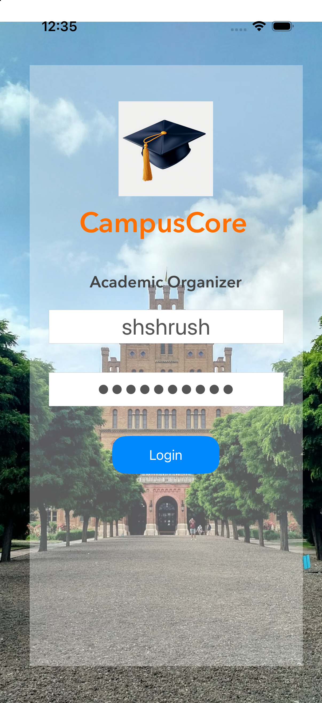
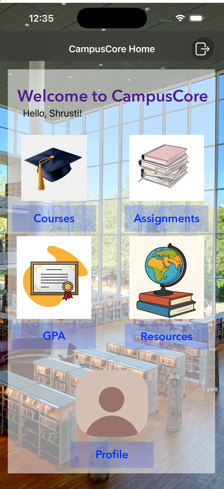
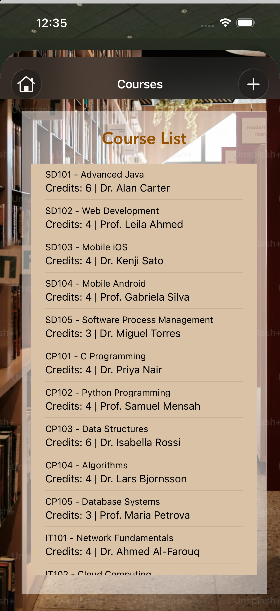
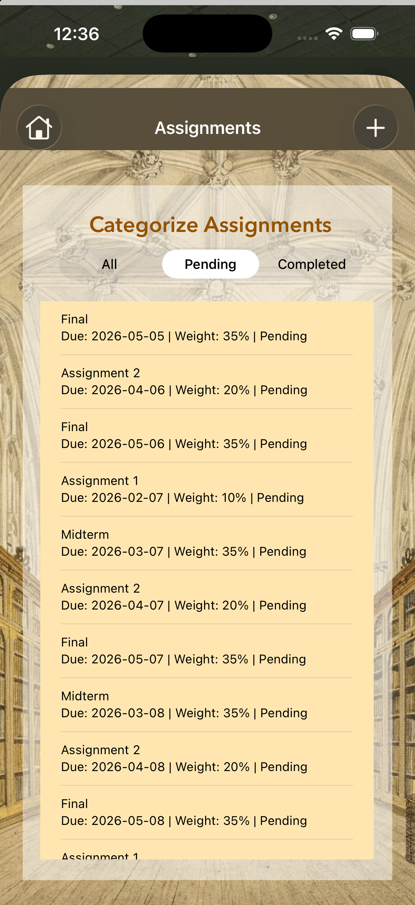
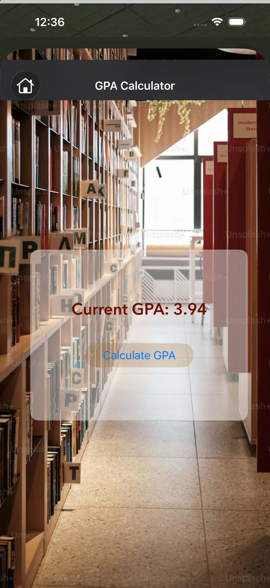
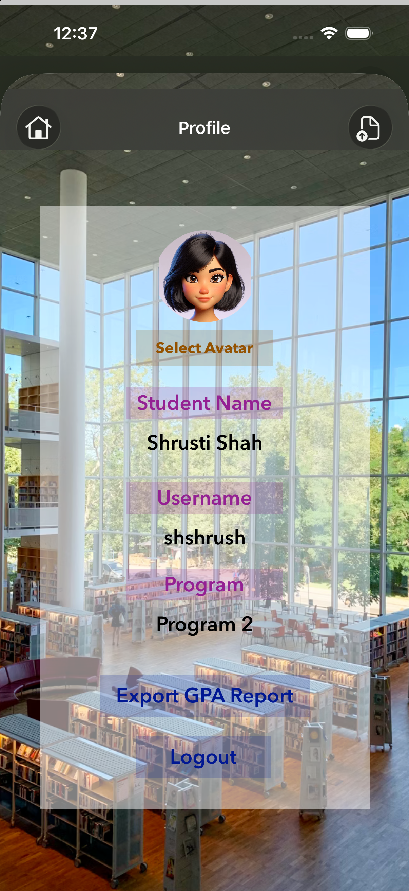
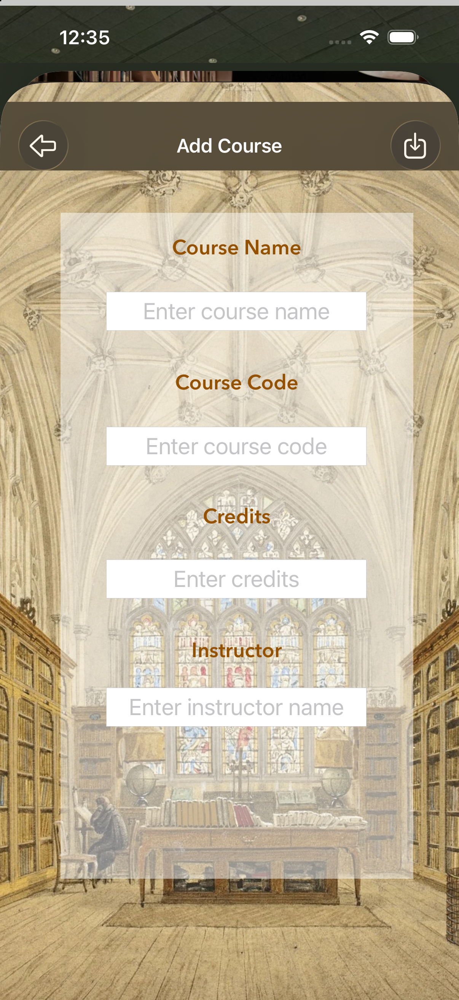
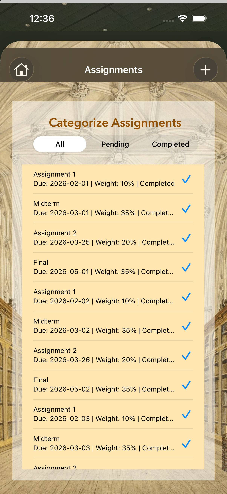
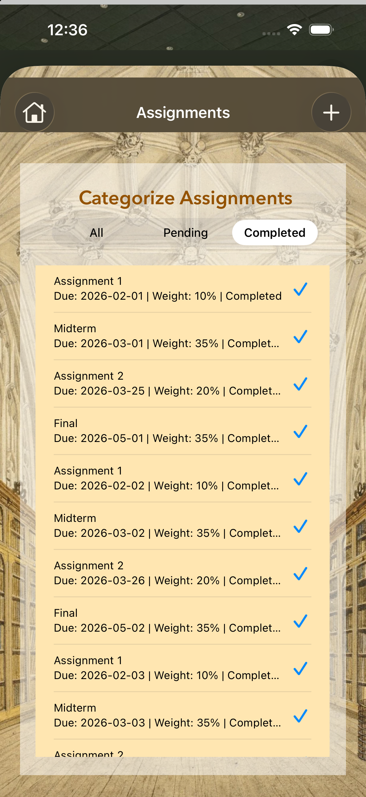
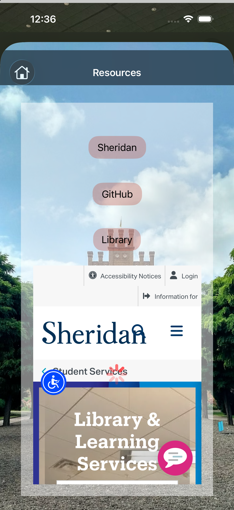

<div align="center">

# CampusCore

### A native iOS academic organizer

Courses, deadlines, academic progress, and campus resources — together in one app.


[App Preview](#app-preview) · [Features](#features) · [Technology Stack](#technology-stack) · [Run Locally](#run-locally)

</div>

## Overview

CampusCore helps students organize their academic routine through a native iOS interface. A personalized dashboard connects course management, assignment tracking, GPA calculation, campus resources, and student profiles.

Developed for the Mobile iOS Application Development course at Sheridan College, the project demonstrates Swift programming, UIKit screen design, SQLite persistence, and integration with Apple's authentication, notification, audio, and PDF APIs.

## App Preview

Screenshots from the running app on an iPhone 17 Pro simulator. Select an image to view it at full resolution.

<table>
  <tr>
    <th align="center">Student Login</th>
    <th align="center">Home Dashboard</th>
    <th align="center">Course List</th>
  </tr>
  <tr>
    <td align="center"><a href="docs/screenshots/login.png"></a></td>
    <td align="center"><a href="docs/screenshots/home.png"></a></td>
    <td align="center"><a href="docs/screenshots/courses.png"></a></td>
  </tr>
  <tr>
    <th align="center">Pending Assignments</th>
    <th align="center">GPA Calculator</th>
    <th align="center">Student Profile</th>
  </tr>
  <tr>
    <td align="center"><a href="docs/screenshots/assignments-pending.png"></a></td>
    <td align="center"><a href="docs/screenshots/gpa.png"></a></td>
    <td align="center"><a href="docs/screenshots/profile.png"></a></td>
  </tr>
</table>

<details>
<summary><strong>More screens: add a course, assignment filters, and campus resources</strong></summary>
<br>

<table>
  <tr>
    <th align="center">Add Course</th>
    <th align="center">All Assignments</th>
  </tr>
  <tr>
    <td align="center"><a href="docs/screenshots/add-course.png"></a></td>
    <td align="center"><a href="docs/screenshots/assignments-all.png"></a></td>
  </tr>
  <tr>
    <th align="center">Completed Assignments</th>
    <th align="center">Campus Resources</th>
  </tr>
  <tr>
    <td align="center"><a href="docs/screenshots/assignments-completed.png"></a></td>
    <td align="center"><a href="docs/screenshots/resources.png"></a></td>
  </tr>
</table>

</details>

## Features

| Feature | What it does |
| --- | --- |
| **Student authentication** | Validates login details against SQLite and supports Face ID or Touch ID after an initial login. |
| **Personalized dashboard** | Welcomes the student and provides direct access to the main modules. |
| **Course management** | Lists, adds, and deletes courses with codes, credits, and instructor information. |
| **Assignment tracking** | Records deadlines and weights, updates completion status, and filters by All, Pending, or Completed. |
| **Local reminders** | Schedules assignment notifications one day before the due date. |
| **GPA calculation** | Converts numeric course results to GPA points and calculates a credit-weighted average. |
| **Profile customization** | Displays student details and provides a choice of profile avatars. |
| **PDF reports** | Generates an academic summary containing profile details and GPA, with a native share sheet. |
| **Campus resources** | Opens college, library, and GitHub links through an embedded web view. |
| **Interaction feedback** | Uses animations and bundled sounds for selected app interactions. |

## Technology Stack

| Language / Technology | Role in the project |
| --- | --- |
| **Swift** | Models, application logic, view controllers, and helper classes; Swift 5 language mode. |
| **SQL / SQLite3** | Relational data storage, queries, and database operations. |
| **XML** | Storyboards and property-list configuration. |
| **UIKit / Interface Builder** | Native layouts, table views, forms, navigation, and storyboard connections. |
| **LocalAuthentication** | Biometric authentication with Face ID / Touch ID. |
| **UserNotifications** | Assignment reminders and foreground notification presentation. |
| **WebKit** | In-app web browsing with `WKWebView`. |
| **AVFoundation** | Playback of bundled WAV sounds. |
| **Foundation / UserDefaults** | Date handling, file operations, and saved preferences. |
| **UIGraphicsPDFRenderer** | Academic summary PDF generation. |
| **Xcode** | iOS development, Interface Builder, and simulator builds. |

The app uses Apple frameworks and the system SQLite library, with no third-party package installation required.

## Implementation Highlights

- **Model–view–controller structure:** Student, course, and assignment models represent data; UIKit view controllers handle screen interactions.
- **Local persistence:** The bundled database is copied to the app's Documents directory on first launch so records can be modified locally.
- **Parameterized SQL:** Login validation and insert operations bind values to SQLite statements.
- **Focused helper classes:** GPA calculation, notification scheduling, and audio playback are handled by dedicated classes.
- **Native platform integration:** Biometrics, notifications, web content, PDF rendering, and sharing are connected to the student workflow.

### Project Structure

```text
CampusCore.xcodeproj/          Xcode project and build configuration
CampusCore/
├── Classes/                  Models, database access, GPA, reminders, and audio
├── ViewControllers/          Screen logic and user interactions
├── Base.lproj/               Main and launch storyboards
├── Database/                 Bundled campuscoredb.db
├── images/                   Asset catalog, backgrounds, and avatars
├── sounds/                   Bundled WAV audio
└── Info.plist                Application configuration
docs/screenshots/             App screenshots used in this README
```

## Run Locally

### Requirements

- macOS with Xcode 16 or later.
- An installed iOS simulator runtime, or a device running iOS 18.0 or later.
- A development team and signing configuration for physical-device builds.

### Setup

1. Clone the repository:

   ```bash
   git clone https://github.com/Shrustiii/campusCore.git
   cd campusCore
   ```

2. Open **`CampusCore.xcodeproj`** in Xcode.
3. Select the **CampusCore** scheme and an iPhone simulator.
4. Press **Command + R** to build and run.
5. Sign in using an existing account from the bundled database.
6. Allow notifications to try assignment reminders.

For a physical device, configure the target's **Signing & Capabilities** with your own development team and bundle identifier. The project currently uses manual signing.

### Check the Local Database

From the repository root, list the available student accounts:

```bash
sqlite3 -header -column CampusCore/Database/campuscoredb.db \
  "SELECT id, name, username FROM student;"
```

The database is included as part of the original educational project. Reinstalling the app resets its local database to the bundled version. Biometric login requires a successful password login first and biometric availability or simulator enrollment. Web resources require an internet connection.

### Build from Terminal

```bash
xcodebuild -project CampusCore.xcodeproj \
  -scheme CampusCore \
  -configuration Debug \
  -sdk iphonesimulator \
  -destination 'generic/platform=iOS Simulator' \
  CODE_SIGNING_ALLOWED=NO build
```

## Project Context

CampusCore is an educational portfolio project showcasing native iOS development and local database integration. Its GPA scale is defined in `GPAEngine.swift`; calculated results are for demonstration rather than an official academic transcript.
